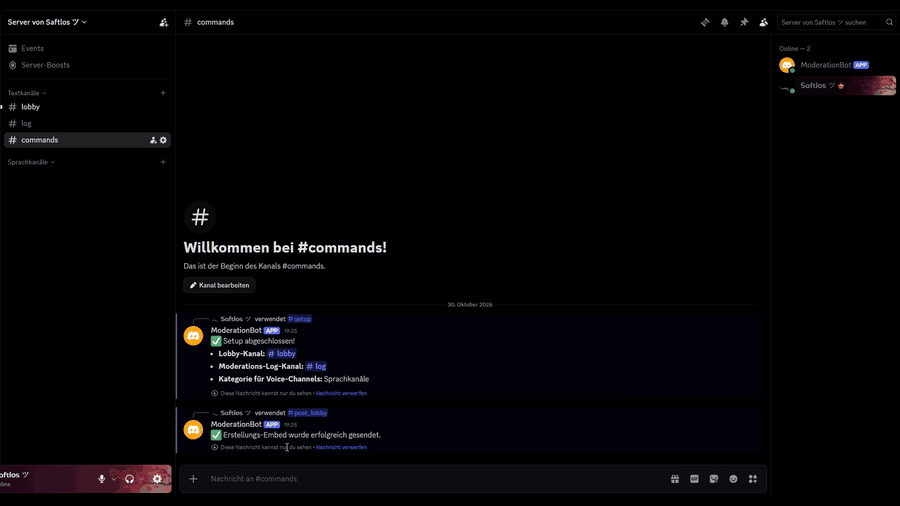

# Temp Voice Channels mit KI-Moderation

Ein Discord-Bot, mit dem Mitglieder per Knopfdruck eigene Voice-Channels erstellen.
Jeder Channel-Name wird automatisch von **Gemma 4** (Google AI) geprüft, bevor er sichtbar wird.
Leere Channels räumt der Bot selbst wieder weg.



*Live-Aufnahme vom Testserver, [Video in voller Auflösung](docs/demo.mp4)*

## Funktionen

- **Self-Service Voice-Channels**: Button in der Lobby, Name eingeben, fertig
- **Keine Wartezeit**: Der Channel entsteht sofort mit Platzhalter-Namen, die KI-Prüfung läuft im Hintergrund
- **Direkt drin**: Wer schon in einem Voice-Channel ist, wird automatisch verschoben, alle anderen bekommen einen „Channel beitreten“-Button
- **Mehrstufige Moderation**: Whitelist → Sperrliste → Cache → KI. Die KI wird nur gefragt, wenn nichts Lokales entscheiden kann
- **Schutz gegen Tarnung**: Vollbreite, Kreis- oder Fraktur-Buchstaben und Zalgo werden vor jeder Prüfung normalisiert. Kyrillische Doppelgänger und Leetspeak erkennt Gemma
- **Admin-Log**: Jede Entscheidung landet als JSON-Log im Mod-Kanal, mit Buttons zum Löschen oder manuellen Freigeben
- **Auto-Cleanup**: Verlässt die letzte Person den Channel, wird er gelöscht, ebenso Channels, denen 30 Sekunden lang niemand beitritt. Nur bot-eigene Channels werden angefasst

## So funktioniert die Moderation

```
Eingabe  ──►  Normalisierung (NFKC + Combining Marks entfernen)
                 │
                 ├─ alle Wörter in whitelist.txt?    ──►  ✅ freigegeben   (Local_Whitelist)
                 ├─ Begriff aus blocklist.txt?        ──►  ❌ abgelehnt     (Local_Blocklist)
                 ├─ Name schon einmal geprüft?        ──►  Ergebnis aus Cache (Local_Cache)
                 └─ sonst: Gemma 4 fragen             ──►  ✅ / ❌ + Begründung (AI_Gemma_4)
```

Fehler (API nicht erreichbar, kaputte Antwort) führen immer zu **Ablehnung**, nie zu einer Freigabe.
Ein Admin kann jeden abgelehnten Namen per Button trotzdem freigeben.

## Einrichtung

1. **Python 3.10+** installieren
2. Abhängigkeiten installieren:
   ```bash
   pip install -r requirements.txt
   ```
3. `.env.example` nach `.env` kopieren und ausfüllen:
   - `DISCORD_TOKEN`: Bot-Token aus dem [Discord Developer Portal](https://discord.com/developers/applications)
   - `GEMINI_API_KEY`: API-Key aus [Google AI Studio](https://aistudio.google.com/apikey)
4. Bot starten:
   ```bash
   python bot.py
   ```
5. Auf dem Server (als Admin):
   - `/setup lobby_channel:#lobby log_channel:#mod-log category:Voice` legt die Kanäle fest
   - `/post_lobby` postet den Erstellen-Button in die Lobby

**Benötigte Bot-Rechte:** Kanäle verwalten, Mitglieder verschieben, Nachrichten senden, Links einbetten.

## Projektstruktur

| Datei | Inhalt |
|---|---|
| `bot.py` | Discord-Logik: Lobby-Button, Modal, Admin-Buttons, Slash-Befehle, Auto-Cleanup |
| `moderator.py` | Moderations-Pipeline: Normalisierung, Listen, Cache, Gemma-API |
| `config.py` | Lädt `.env` (Secrets) und `config.json` (Server-IDs, wird von `/setup` geschrieben) |
| `whitelist.txt` / `blocklist.txt` | Ein Begriff pro Zeile, Änderungen gelten ohne Neustart |

## Technik

- [discord.py](https://github.com/Rapptz/discord.py) 2.x mit persistenten Views (Buttons funktionieren auch nach Neustart)
- Google Generative Language API mit `gemma-4-26b-a4b-it` (über `GEMMA_MODEL` änderbar)
- Blockierende API-Aufrufe laufen über `asyncio.to_thread`, damit der Bot nie hängt
- Retries mit wachsender Wartezeit bei API-Fehlern
